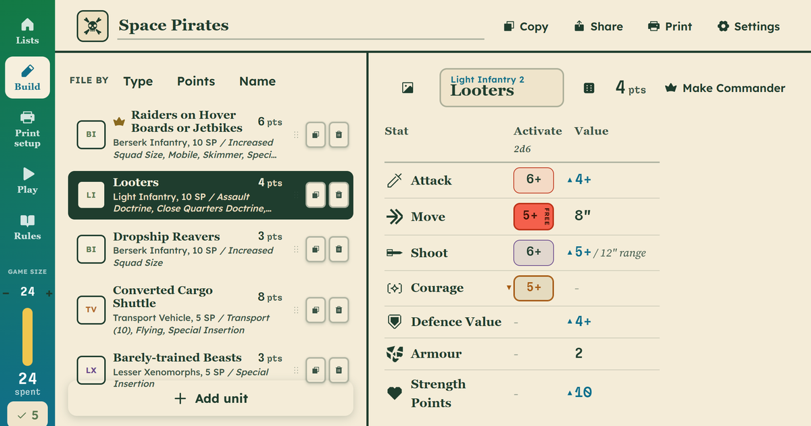

<div align="center">

[](https://type37.github.io/xenos-rampant-force-builder/)

# Xenos Rampant Detachment Builder

### [Open it](https://type37.github.io/xenos-rampant-force-builder/)

</div>

Assemble and print your detachment in this unofficial detachment builder for [Xenos Rampant](https://www.ospreypublishing.com/us/xenos-rampant-9781472852366/), published by Osprey Games. This web app was designed by WarLore.

## What it does

- Every unit, option and xeno rule, at full rules text.
- Points update live and the list keeps itself legal.
- Roll or pick Commander traits.
- Ready-made detachments, including Combat Patrol boxes rebuilt as Xenos Rampant forces.
- Print sheet, and a tracker for damage, activations and turns.
- Share as a link. No account, works on a phone.

## Design decisions

- Dresses as its own rulebook. This one is the Field Almanac: cream paper, bottle-green ink, coral as fill and never as small text.
- Hyper Scrypt titles, Sligoil Micro for numbers, Source Serif for prose. Open fonts from [Velvetyne](https://velvetyne.fr), bundled not fetched.
- Activation rolls get tinted die chips so they never read as bare profile values.
- One icon set, inlined. A CDN icon breaks offline.
- Modals and number fields come from [Astryx](https://github.com/facebook/astryx), skinned to the Almanac. One Escape closes one modal, focus stays inside, and a half typed number stays put.
- The oldest skin of the five, and it shows. Due a reskin before the others.

## Still to do

- A print QR code, so a roster reaches a phone without typing a URL.
- The unit-name field in the detail pane clips long names instead of growing.
- 17 presets print different points from what the builder adds up, mostly a force field or exploder with no level. `npm run check:presets` lists them for checking against the book.

## Run it

Vite and React, almost all in `src/App.jsx`, no backend. Node 18+.

```bash
npm install && npm run dev
```

Pushing to `main` deploys to Pages.

## Legal

Xenos Rampant is by Daniel Mersey and Richard Cowen, published by Osprey Games. Unofficial, not affiliated with Osprey. Font licenses ship in `public/fonts/`.

[Buy the game](https://www.ospreypublishing.com/us/xenos-rampant-9781472852366/) · [Report a bug](https://github.com/Type37/xenos-rampant-force-builder/issues/new/choose) · [WarLore](https://linktr.ee/warlore)
